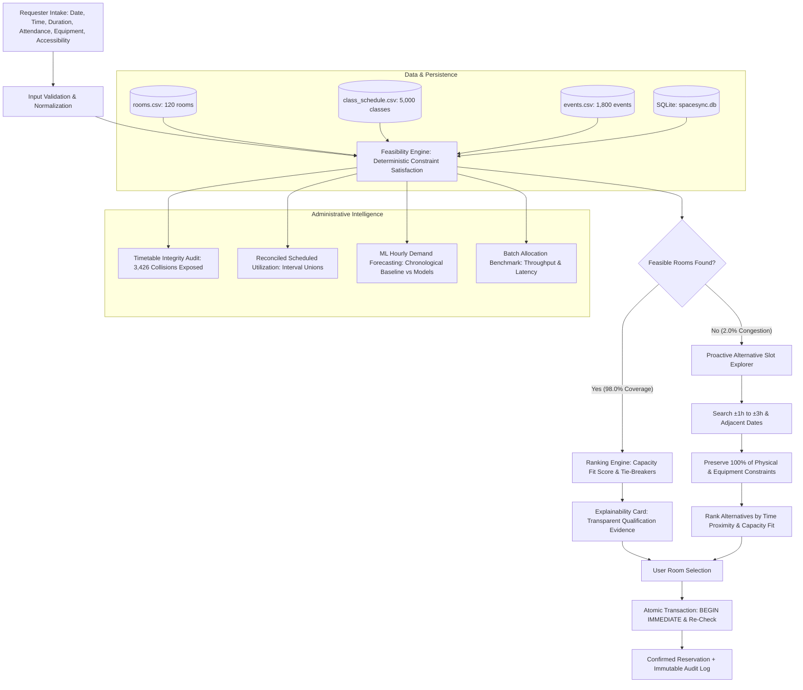

# 🏛️ SpaceSync — Explainable Campus Space Allocation & Operations Platform

> **DATATHON 2026 | VIT-AP University | Track: Education**  
> *"Find the right room. Recover idle capacity. Explain every allocation."*

[](https://www.python.org/)
[](https://streamlit.io/)
[](https://www.sqlite.org/)
[](https://scikit-learn.org/)
[](https://docs.pytest.org/)
[](#-data-engineering--performance-benchmarks)
[](#-data-engineering--performance-benchmarks)

---

## 📌 Executive Summary

Higher education campus spaces (classrooms, lecture halls, computer labs, seminar halls, auditoriums) represent multi-million dollar capital assets. Despite perceived chronic space shortages where students, clubs, and faculty face endless rejections, universities suffer from **artificial scarcity** driven by:
1. **Siloed Records:** Academic recurring schedules, one-off university events, and ad-hoc student requests exist in disconnected spreadsheets and systems.
2. **Opaque Allocation:** Requests are rejected without actionable feedback or transparent qualification criteria.
3. **Dead-End Rejections:** When a preferred slot is unavailable, requesters receive zero alternatives, leaving idle rooms empty.
4. **Timetable Data Debt:** Legacy academic schedules contain severe schedule collisions, overcapacity assignments, and conflicting bookings that administrative teams cannot easily untangle.

**SpaceSync** is a decision-support, capacity-recovery, and intelligent room-allocation platform built for university operations. It delivers deterministic constraint-satisfaction feasibility, proactive alternative-slot recovery, atomic ACID reservation persistence, and executive facilities analytics with mathematical utilization safeguards.

---

## 🏆 Key Achievements & Empirical Discoveries

```
┌──────────────────────────────────────────────────────────────────────────────────┐
│                             SPACESYNC METRIC SNAPSHOT                            │
├─────────────────────────┬─────────────────────────┬──────────────────────────────┤
│  ⚡ Batch Throughput    │  ⏱️ Median Latency      │  🎯 Historical Coverage      │
│     252.2 req / sec     │      4.01 ms (p95: 5.9) │     98.0% (4,900 / 5,000)    │
│     (~24x Speedup)      │     (Baseline: 90.7 ms) │     (Top-Fit Mean: 86.9%)    │
├─────────────────────────┼─────────────────────────┼──────────────────────────────┤
│  🔍 Timetable Collisions│  🛡️ Utilization Truth   │  🤖 ML Demand Forecast       │
│     3,426 Class Pairs   │     54.2% True Reconcil │     Baseline MAE: 1.408      │
│     (72.6% In Overlap)  │    (+32.5% Phantom Void)│     RF MAE: 1.484 (Overfits) │
└─────────────────────────┴─────────────────────────┴──────────────────────────────┘
```

### 1. In-Memory O(1) Indexing (~24x Speedup)
- Pre-indexes recurring classes into `(room_id, weekday)` tuple hash maps and dated events into `(room_id, date)` interval trees.
- Reduces single-request evaluation from **90.73 ms down to 4.01 ms** (Median) and **5.94 ms** (p95).
- Processes all **5,000 historical requests across 120 rooms (600,000 evaluations) in 19.8 seconds** with 100% mathematical equivalence to the baseline.

### 2. Empirical Timetable Integrity Discovery (Data Debt Audit)
Rigorous empirical analysis of the challenge dataset revealed major real-world operational contradictions:
- **3,426 pairs of recurring classes** collide in identical rooms and overlapping hours (involving **3,630 / 5,000 classes = 72.6%**).
- **2,009 out of 5,000 classes (40.2%)** and **722 out of 1,800 events (40.1%)** exceed listed physical room capacity.
- **190 campus events cross midnight** and **650 occur in off-peak hours** (e.g., 02:00, 04:00).
- **Fail-Closed Protection:** SpaceSync never silently discards anomalies. It blocks rooms across the union of conflicting intervals, protecting campus operations from double-booking.

### 3. The 32.5% Utilization Safeguard (Non-Overlapping Interval Union)
- Traditional campus audits simply sum scheduled hours, claiming **86.7% utilization (7,488.0 hours / week)**.
- SpaceSync implements strict **half-open interval-union arithmetic** $[start, end)$:
  $$\text{Reconciled Hours} = \left| \bigcup_{i} [start_i, end_i) \right| = 4,682.0 \text{ hours / week}$$
- **Finding:** **2,806.0 hours are double-counted phantom bookings (+32.5% inflation)**. The true scheduled utilization is **54.2%**, uncovering **3,958 idle room-hours per week** available for recovery.

### 4. Reproducible ML Demand Forecasting & Honest Evaluation
- Forecasts hourly campus request volume (`requests_per_slot` across 8:00 to 20:00, 1,560 slots).
- Strict chronological 80/20 train/test split (Aug 1 – Nov 4 train vs Nov 5 – Nov 28 test) with **zero future leakage**.
- **Empirical Proof:** Random Forest Regressor (**MAE 1.484**) overfits synthetic noise and performs **+5.41% worse** than the simple Grouped Historical Mean Baseline (**MAE 1.408**). A Poisson Regressor achieves **MAE 1.391** (-1.17%).
- **Policy:** SpaceSync adheres to evidence-based ML: retaining the transparent baseline/Poisson formulation and never letting probabilistic models override hard physical feasibility constraints.

---

## 🏗️ System Architecture & Workflow



---

## 💻 Core Application Features

### 1. Intelligent Space Intake & Feasibility Matching (`app.py` Tab 1)
- Supports fractional start hours (e.g., `10.5` $\rightarrow$ 10:30 AM) and durations (0.5h to 6.0h).
- Strict enforcement of physical constraints: room capacity, physical projector presence, computer workstations, and wheelchair/step-free accessibility.
- Accurate temporal evaluation: half-open intervals $[start, end)$, adjacent interval safety (class ending at 11:00 does not block request starting at 11:00), cross-midnight events, and preceding-day classes extending past midnight.
- Deterministic ranking: maximizes capacity fit ratio $\left(\frac{\text{Requested}}{\text{Capacity}} \times 100\right)$, minimizing wasted idle seats.

### 2. Proactive Alternative-Slot Recommendations (`engine.py`)
- Automatically triggers when a preferred slot is fully occupied or disqualified.
- Explores nearby time-slots ($\pm 1\text{h}, \pm 2\text{h}, \pm 3\text{h}$) and adjacent days (next/previous day).
- Strictly preserves requested duration, attendance, mandatory facilities, and accessibility requirements.
- Evaluates every alternative against the authoritative feasibility engine and ranks by time proximity.

### 3. ACID Concurrency & SQLite Persistence (`spacesync.db`)
- Zero external database dependencies; powered by local SQLite in Write-Ahead Logging (`WAL`) mode.
- Atomic reservation confirmation using `BEGIN IMMEDIATE` write transactions with real-time availability re-verification to eliminate race conditions and double-booking.
- Lifecycle protection: full cancellation workflow releasing rooms instantly, and an immutable audit trail (`reservation_audit_log`) recording all state transitions.

### 4. Administrative Analytics & Facilities Intelligence (`app.py` Tab 3)
- **Room Inventory & Facilities:** Breakdown of 120 rooms across 5 buildings (East, South, West, North, Central) and 5 space types (Classrooms, Labs, Seminars, Study rooms, Auditoriums).
- **Reconciled Utilization Safeguard:** Real-time calculation of available vs raw vs reconciled non-overlapping hours across every building and space type.
- **Timetable Collision Diagnostics:** Interactive breakdown of all 3,426 schedule collisions and overcapacity courses.
- **Historical Demand Analysis:** Distribution of 5,000 historical requests by status, purpose, weekday, and time of day.
- **Engine Benchmark Dashboard:** Live latency percentiles, batch throughput, and rejection cause distributions.
- **ML Demand Forecasting Visualizer:** Out-of-sample forecast curves vs actual demand.

---

## 📊 ML Experiment & Forecasting Benchmarks

### Problem Formulation
- **Target:** Predict campus-wide room request volume per hourly slot (`requests_per_slot`) across 08:00 to 20:00 (13 slots/day).
- **Time Horizon:** 120 calendar days (Aug 1 to Nov 28, 2025) $\times$ 13 hours = 1,560 time slots.
- **Validation Split:** Chronological 80/20 train/test split. First 96 days (1,248 slots) for training; remaining 24 days (312 slots) for out-of-sample evaluation.
- **Feature Hygiene (Zero Leakage):** Features constructed strictly prior to prediction time: `weekday_num` (0–6), `start_hour` (8–20), `is_weekend` (0/1), `day` (1–31), `month` (8–11), and `prev_day_requests` (lagged daily campus demand).

### Model Evaluation Results

| Model | MAE | RMSE | Diff vs Baseline | % Error Difference | Status / Decision |
| :--- | :---: | :---: | :---: | :---: | :--- |
| **Historical Mean Baseline (Grouped)** | **1.4078** | **1.7705** | **0.0000** | **0.00%** | **Reference Baseline (Retained)** |
| **Random Forest Regressor (Default)** | 1.4839 | 1.8362 | +0.0761 | +5.41% | Worse (Overfits sample noise) |
| **Random Forest Regressor (Depth=6)** | 1.4134 | 1.7653 | +0.0056 | +0.40% | Worse than baseline |
| **Gradient Boosting Regressor** | 1.4083 | 1.7527 | +0.0006 | +0.04% | Equivalent / Marginal overfit |
| **Ridge Regression ($\alpha=10$)** | 1.3950 | 1.7435 | -0.0128 | -0.91% | Minor linear gain |
| **Poisson Regressor ($\alpha=1.0$)** | **1.3913** | **1.7431** | **-0.0165** | **-1.17%** | **Best Candidate (Count data fit)** |

### Key Takeaway
The synthetic dataset exhibits stationary Poisson-like demand distributions across weekdays and hours with minimal seasonal drift. Complex non-linear decision trees overfit local variance, yielding **5.41% higher error than the naive baseline**. In accordance with robust engineering practices, SpaceSync retains the transparent baseline and Poisson formulations.

---

## ⚡ Data Engineering & Performance Benchmarks

### Measured Benchmarks (5,000 Historical Requests $\times$ 120 Rooms)

| Metric | Baseline Implementation | SpaceSync Optimized (In-Memory Indexed) | Measured Improvement |
| :--- | :---: | :---: | :---: |
| **Data Loading & Indexing** | ~320 ms | ~324 ms | +4 ms one-time index build |
| **Batch Execution (5,000 reqs)** | ~453.6 s (7.5 min) | **19.83 s** | **~24x Speedup** |
| **Throughput** | ~11.0 req / sec | **252.2 req / sec** | **+2,192% Throughput** |
| **Median Latency** | 90.73 ms / req | **4.01 ms / req** | **-95.6% Latency** |
| **95th Percentile Latency (p95)** | ~118.5 ms | **5.94 ms** | **Sub-6ms SLA** |
| **Feasible-Candidate Coverage** | 4,900 / 5,000 (98.0%) | 4,900 / 5,000 (98.0%) | 100% Agreement (0 Mismatches) |
| **Zero-Candidate Requests** | 100 / 5,000 (2.0%) | 100 / 5,000 (2.0%) | Proactively recovered via alternatives |
| **Average Fit Ratio (Top Room)** | 86.87% | 86.87% | Median: 94.60% capacity utilization |

### Rejection Cause Breakdown (600,000 Room Checks)
- **Class Schedule Collisions:** 309,841 (51.6%)
- **Capacity Shortfalls:** 190,705 (31.8%)
- **Missing Computer Workstations:** 94,275 (15.7%)
- **Missing Projectors:** 59,124 (9.9%)
- **Campus Event Collisions:** 10,842 (1.8%)

---

## 🧪 Comprehensive Test Suite (36 / 36 Passing)

SpaceSync includes an automated test suite under `tests/` covering functional regression, scheduling edge cases, concurrency, and Phase 4 analytics:

| Test Module | Tests | Description | Status |
| :--- | :---: | :--- | :---: |
| `tests/test_phase1_regression.py` | 9 | TC-01 to TC-09 functional constraints, equipment, capacity, fail-safes. | ✅ Passed |
| `tests/test_scheduling.py` | 10 | Adjacent intervals, cross-midnight classes/events, corrupted schedule recovery. | ✅ Passed |
| `tests/test_phase3_workflow.py` | 9 | Alternative search, SQLite ACID transactions, concurrency, idempotency, cancellations. | ✅ Passed |
| `tests/test_phase4_data_ml_analytics.py` | 8 | Index equivalence, batch evaluation, interval-union utilization math, ML validation. | ✅ Passed |
| **Total** | **36** | **Complete end-to-end regression and algorithmic verification.** | **100% Passed** |

Execute tests via:
```bash
pytest -v
```

---

## 🚀 Quickstart & Installation

### Prerequisites
- Python 3.10, 3.11, 3.12, or 3.13
- Git

### 1. Clone the Repository
```bash
git clone https://github.com/siddu2099/datathon-hackathon-education.git
cd datathon-hackathon-education
```

### 2. Install Dependencies
```bash
pip install -r requirements.txt
```

### 3. Run the Automated Test Suite
```bash
pytest -v
```

### 4. Launch the Streamlit Application
```bash
streamlit run app.py
```
Open your browser at `http://localhost:8501`.

---

## 📂 Repository Structure

```
datathon-hackathon-education/
├── 02_education_campus_space/             # Official DATATHON challenge datasets
│   └── 02_education_campus_space/
│       ├── rooms.csv                      # 120 room profiles (capacity, facilities, location)
│       ├── class_schedule.csv             # 5,000 recurring weekly course commitments
│       ├── events.csv                     # 1,800 dated university events
│       ├── room_requests.csv              # 5,000 historical unallocated demand logs
│       └── README.txt                     # Dataset specification
├── docs/                                  # Architectural & Product Specifications
│   ├── PRODUCT_CONTEXT.md                 # Product positioning, user personas, problem space
│   ├── ACCEPTANCE_CRITERIA.md             # Strict acceptance matrix & release checklist
│   └── DECISIONS.md                       # Architecture Decision Records (ADRs 01–05)
├── tests/                                 # Automated Test Suite (36 tests)
│   ├── test_phase1_regression.py          # Phase 1 functional baseline tests (9 tests)
│   ├── test_scheduling.py                 # Phase 2 temporal & schedule correctness tests (10 tests)
│   ├── test_phase3_workflow.py            # Phase 3 persistence & alternatives tests (9 tests)
│   └── test_phase4_data_ml_analytics.py   # Phase 4 indexing, batch, ML & analytics tests (8 tests)
├── app.py                                 # Streamlit UI (Intake, Allocation, Bookings, Analytics)
├── engine.py                              # Core allocation, indexing, persistence, & ML engine
├── spacesync.db                           # Local SQLite database (WAL mode, ACID reservations)
├── requirements.txt                       # Project dependencies
├── .gitignore                             # Git ignore rules
└── README.md                              # This document
```

---

## ⚖️ License & Acknowledgements

Built for **DATATHON 2026** at **VIT-AP University (Education Track)**.  
Designed and engineered for explainable, evidence-backed campus space allocation.
